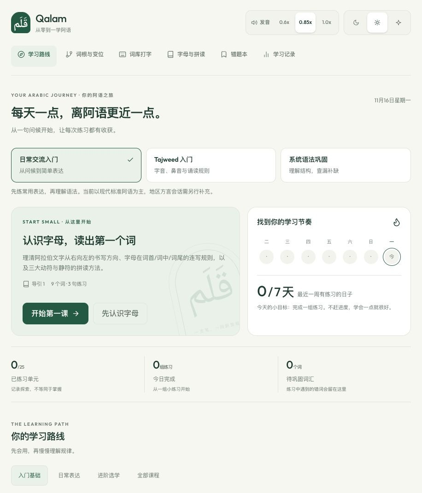

# 🖋️ Qalam (قَلَم) ·「从零到一」阿拉伯语学习平台

> **灵感来源**：融合 [cuixiaorui/earthworm](https://github.com/cuixiaorui/earthworm)（阶梯式连词成句学语法）、[RealKai42/qwerty-learner](https://github.com/RealKai42/qwerty-learner)（肌肉记忆键盘盲打）与《麦地那阿语教程》的经典语法体系。  
> 专为零基础学习者打造：从 28 个字母与动符拼读出发，掌握三母词根派生与词尾变格规律，亲手在键盘上敲出地道的阿语句子。

---

## 界面预览

### 学习首页

日常交流入门、Tajweed 入门与系统语法巩固三个目标入口，配合今日推荐、学习记录和分阶段课程。



### Tajweed 入门

6 个规则单元、19 道概念辨析题，学习短长音、鼻音、静音 ن／م、弹音与基础停连；自测记录规则理解，不评价实际诵读发音。


---

## 当前范围与验证

当前支持三个目标：**日常交流入门、Tajweed（诵读规则）入门、系统语法巩固**。语言课程共25个单元（3导引+22正课），含61个讲解点、73道固定造句、50道随堂题；专项语法测验36题。Tajweed另设规则学习与概念自测，不包含经典原文精读、释义或注释，也不使用普通TTS作为诵读示范。

课程完成与规则自测不等同长期掌握或实际发音达标。当前没有延迟复测、完整的听说课程或全三册教材覆盖验证。下方清单用于介绍已有主题，不作为完整教学效果承诺。课程与内容缺口详见 [项目评估](docs/project-review.md)、[课程审计](docs/curriculum-audit.md) 和 [Tajweed 范围与来源](docs/tajweed-scope.md)。

新版包括三种目标入口、响应式学习首页、可点击阿语键盘、实际练习统计，以及辅助/无答案提示造句的区分；学习记录保存在当前浏览器。

```bash
npm run build
npm run lint
npm test
```

运行回归检查需要支持直接加载TypeScript的Node.js（22.18+或24+）。

---

## 🌟 学习模块

### 1. 🗺️ 主线课程（3 个导引 + 22 个正课单元）
从零基础文字连写、日常寒暄与三母构词导引篇出发，参考《麦地那阿拉伯语教程（Durūs al-Lughah al-ʿArabiyyah）》相关语法主题组织讲解与练习。每课均配备 **概念导读与课堂对话 + 语法讲义与随堂自测 + 看词选义练习 + 逐词句法剖析（الإِعْرَاب）**：
- **阶段零 · 导引篇（导引 1 ~ 3）**：文字连写变形与三大动符拼读（`ب + ي + ت = بَيْت`）、6 个单向连写字母、日常问候与基础自我介绍（`مَرْحَبًا · أَنَا`）、三母词根（`الجَذْر`）与派生词型（`الوَزْن`）导论。
- **第 1 课 · 这是什么（`هَذَا وَهَذِهِ`）**：近指指示代词、阴阳性标志 `ة`（圆形 ت）、无系动词的名词句。
- **第 2 课 · 房子很大 vs 大房子（`الْمُبْتَدَأ وَالْخَبَر`）**：定冠词 `الـ` 与鼻音符的互斥铁律、如何通过定指差区分「句子」与「形容词短语」。
- **第 3 课 · 在哪里？介词与属格（`حُرُوفُ الْجَرِّ`）**：主格 (`-u`)、宾格 (`-a`)、属格 (`-i`) 入门，掌握 `فِي / عَلَى / مِنْ / إِلَى` 引起的属格变化。
- **第 4 课 · 谁的东西？正偏组合（`الإِضَافَة`）**：「正次去冠去鼻音，偏次永远处于属格」的黄金定律。
- **第 5 课 · 我的与你的：代词与物主后缀（`الضَّمَائِر`）**：独立人称代词与词尾附着代词（`ـِي / ـكَ / ـهُ / ـهَا`）。
- **第 6 课 · 动词句与过去式（`الْفِعْلُ الْمَاضِي`）**：VSO 语序、主语主格与宾语宾格、过去式人称词尾变位。
- **第 7 课 · 现在式、将来时与否定（`الْمُضَارِع وَالنَّفْي`）**：`أَنَيْتُ` 前缀法则、`سَـ` 将来时前缀，以及 `لَا / مَا / لَيْسَ` 三大否定体系。
- **第 8 课 · 地道寒暄与日常表达（`الْمُحَادَثَة`）**：解剖 `السَّلَامُ عَلَيْكُمْ`、`صَبَاحَ الْخَيْرِ` 等日常高频表达背后的语法结构。
- **第 9 课 · 双数、完整复数与「非人复数」法则（`الْمُثَنَّى وَالْجَمْع`）**：双数词尾（`ـَانِ / ـَيْنِ`）、阳性完整复数（`ـُونَ / ـِينَ`）、阴性完整复数（`ـَات`），以及「一切非人复数视同阴性单数」的黄金定律。
- **第 10 课 · 变格双雄：强调词 `إِنَّ` 与过去系动词 `كَانَ`（`كَانَ وَإِنَّ`）**：掌握两大名词句改造器——`إِنَّ`（立宾扬主）与 `كَانَ`（扬主立宾）。
- **第 11 课 · 比较级、最高级与半变尾词（`اسْمُ التَّفْضِيل · أَفْعَل`）**：`أَفْعَلُ + مِنْ`（比…更…）、`أَفْعَلُ + 泛指单数属格`（最…的…），以及半变尾词（`الممنوع من الصرف`）不标鼻音符规则。
- **第 12 课 · 数词与量词的「阴阳反配」铁律（`العَدَد وَالْمَعْدُود`）**：`1~2` 同性作定语，`3~10` 数词与名词单数性别相反 + 复数属格，`11~99` 后接泛指单数宾格（`-an`）。
- **第 13 课 · 命令式与禁止式（`الأَمْر وَالنَّهْي`）**：祈使命令式（`اُكْتُبْ / اِجْلِسْ`）与否定禁止式（`لَا تَخْرُجْ` · 切音格静符）。
- **第 14 课 · 关系代词与定语从句（`الِاسْمُ الْمَوْصُول · الَّذِي / الَّتِي`）**：确指先行词加 `الَّذِي / الَّتِي` 与泛指先行词直接接从句的对比。
- **第 15 课 · 现在式三态变位：宾格（`أَنْ / لَنْ`）与切音格（`لَمْ`）**：掌握现在式动词的主格 (`-u`)、宾格 (`-a`) 与切音格 (`-ْ` 表过去否定)。
- **第 16 课 · 被动语态（`المَبْنِيّ لِلْمَجْهُول`）与状态状语（`الحَال`）**：过去被动「首合倒二齐（`كُتِبَ / فُتِحَ`）」、代主语主格，以及泛指宾格作伴随状语与原因目的宾语。
- **第 17 课 · 呼格（`النِّدَاء · يَا`）与指示同位语（`البَدَل · هَذَا الْبَيْتُ`）**：单名呼格去鼻音标 `-u` vs 正偏组合呼格标宾格 `-a`；区分 `هَذَا الْبَيْتُ`（这所房子·同位语）与 `هَذَا بَيْتٌ`（这是一所房子·句子）。
- **第 18 课 · 五名词长音变格（`الأَسْمَاءُ الْخَمْسَة · أَبُوكَ / أَخُوكَ / ذُو`）**：`أَبٌ / أَخٌ / ذُو` 作正次时用长音 `و / ا / ي` 分别表示主格、宾格与属格。
- **第 19 课 · 柔母弱动词与重母动词全解（`الأَفْعَالُ الْمُعْتَلَّة وَالْمُضَعَّف`）**：首柔词 (`وَصَلَ → يَصِلُ` 丢 `و`)、中空词 (`قَالَ → قُلْتُ` 缩合)、尾柔词 (`مَشَى → لَمْ يَمْشِ` 砍长音) 与重母词 (`أَحَبَّ → أَحْبَبْتُ` 拆叠音)。
- **第 20 课 · 条件句体系：双切音条件句（`إِنْ / مَنْ`）与假定句（`إِذَا / لَوْ`）**：一砍砍两个动词的双切音条件句（`مَنْ يَجْتَهِدْ يَنْجَحْ`）、实然条件词 `إِذَا` 与反事实虚拟条件词 `لَوْ ... لَـ`。
- **第 21 课 · 例外句（`إِلَّا`）、感叹式（`مَا أَجْمَلَ`）与绝对宾语（`المَفْعُول المُطْلَق`）**：`إِلَّا` 后接宾格被排除词、`مَا أَفْعَلَ + 宾格` 感叹式、以及动词后接同源 Masdar 宾格的绝对宾语。
- **第 22 课 · 大结局：三母复式动词（第 II~X 式）与派生名词体系综合实战（`المُشْتَقَّات وَالأَوْزَان`）**：掌握第 II~X 式复式动词派生名词「词首 `مُـ` + 倒数第二字母 `-i-`（主动名词）/ `-a-`（被动名词与时空名词）」的统一规律与复合长句剖析。

### 2. 🔊 双引擎语音合成、音节切分与中文谐音助记
- **云端 + 系统原生双引擎发音**：尝试云端TTS并回退到系统语音；实际可用性取决于网络、浏览器及系统语音包，支持 `0.6x / 0.85x / 1.0x` 全局语速切换及单卡 `0.55x 慢读`。
- **音节拆解与中文谐音提示**：自动将拉丁转写切分为音节（如 `mu·dar·ri·sun`）并生成近似中文谐音提示，搭配 20 章「有声词表预览」抽屉，支持先听音认词再进入盲打。

### 3. 🧱 句法造句工坊 & 语法透视台（Earthworm Mode + Sentence X-Ray）
- **🧩 词块连词成句**：看中文提示与听语音，通过点击词块或按数字键 `1~9` 拼出完整阿语句子。
- **⌨️ 整句键盘流式盲打**：在普通英文键盘上直接敲出完整阿语句子（含空格与可选动符），屏幕键盘实时高亮下一个键位。
- **🔬 语法透视台（Sentence X-Ray）**：点击句中任意单词，底部实时解析该词的**语法成分（起词/述语/正次/偏次/主语/宾语）与词尾变格原因**，并按**主格（天青蓝）/ 宾格（琥珀金）/ 属格（翡翠绿）**自动语义着色。

### 4. 🧬 词根、变位与词法实验室（6 大子实验室）
- **三母词根工坊（`الجَذْر` · 18 组高频词根家族）**：收录 `ك-ت-ب`、`د-ر-س`、`ع-ل-م`、`ع-م-ل`、`س-ل-م`、`ف-ت-ح`、`ق-ر-أ`、`خ-ر-ج`、`د-خ-ل`、`ج-ل-س`、`ح-ك-م`、`ح-س-ب`、`س-ف-ر`、`ط-ب-خ`、`ص-ن-ع`、`ز-ر-ع`、`س-ك-ن`、`ش-ر-ب` 等 18 组词根与 100+ 派生词。
- **名词「性·数·格」三维变格沙盒 + 破碎复数 8 种常用词型（`الإِعْرَاب وَجَمْعُ التَّكْسِير`）**：8 组规则名词 3×3×2×2 变格矩阵 + `أَفْعَال / فُعُول / فُعُل / فُعَّال / فِعَال / أَفْعِلَاء / مَفَاعِل / مَفَاعِيل` 八种破碎复数词型与 24 组高频单复数配对。
- **三母简式与复式十式动词总表（`الأَوْزَان العَشَرَة` · I ~ X 式）**：完整解析第 I 式至第 X 式动词的附加词缀结构、核心语义演变及过去式/现在式/词源（动名词）/主动名词四列对比。
- **动词人称变位表（`التَّصْرِيف` · 8 大典型动词）**：涵盖安全动词、海姆宰动词 (`قَرَأَ`)、中空柔母动词 (`قَالَ → قُلْتُ`)、第 II 式 (`عَلَّمَ`)、第 V 式 (`تَعَلَّمَ`) 与第 X 式 (`اِسْتَعْمَلَ`)。
- **派生词型推演台（`الْوَزْن Wazn` · 12 种常用词型）**：详解 12 种核心派生词型，支持实时将三母词根套入不同词型查看派生结果。
- **语法与变位专项测验（36 题分类题库）**：涵盖句法变格、正偏与定语、动词变位、词根与词法四大分类填空自测，配即时语法依据解析与整句朗读。

### 5. 🎨 三套主题配色与无障碍交互
- 内置 **🌙 星夜蓝金（Arabian Nights）**、**☀️ 羊皮纸浅色（Andalusian Daylight）**、**🌿 翡翠流金（Oasis Emerald）** 三套主题一键切换。

### 6. 🔤 字母同形分组导学、动符拼读与太阳月亮字母实验室
- **7 组同形骨架导学 + 连写变形演示台**：按基础字形骨架与点位规律分组掌握 28 个辅音字母，配独立字母连写构词的逐步拆解。
- **28 字母四形态**：独立、词首、词中、词尾四种连写形态、发音部位（含顶音与喉音分级）与例词。
- **动符与拼读规则**：三短音（`َ ِ ُ`）、三长音（`ا ي و`）、静符（`ْ`）、叠音符（`ّ`）、三鼻音符（`ٌ ً ٍ`）的发音对比与语法作用。
- **太阳字母 vs 月亮字母**：直观演示 14 个太阳字母如何同化定冠词 `الـ` 的 `ل` 音。
- **形态辨析测验**：针对同形骨架字母（`ب ت ث ن ي`、`ج ح خ` 等）的辨识测验。

### 7. ⌨️ 20 大主题词库盲打 & 全库实时词典（580+ 词汇）
- 涵盖寒暄礼仪、代词疑问词、家庭亲属、职业身份、基数与序数词、饮食蔬果、人体健康、家居器物、服饰穿戴、城市建筑、交通旅行、自然宇宙、动物、校园教育、时间四季、基础动词、派生式动词、反义形容词与色彩、语法虚词等 **20 大章节 580+ 词汇**。
- 内置**全库词典实时搜索**（支持中文、拉丁音标、带符/无符阿语检索）与搜索结果一键盲打。
- 采用 **ZWJ（零宽连字符）保护技术**，逐字符簇高亮的同时完全保持阿语连写不断裂。

### 6. 📊 错题本与本地学习统计
- 自动收集打错与跳过的词汇，支持错词专项强化，记录连续学习天数、WPM 与正确率趋势。

---

## 🚀 快速启动

```bash
cd /Users/moses/Explore/arabic-learner
npm install
npm run dev
```

浏览器访问 `http://localhost:5173` 即可开始从零到一学习阿拉伯语！
