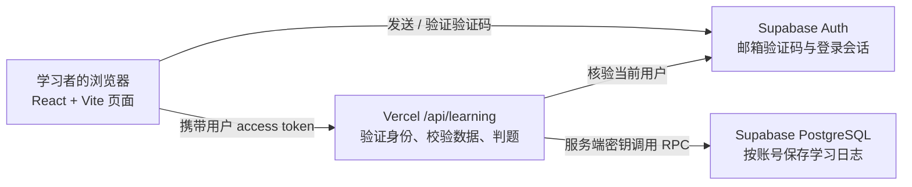

# Vercel + Supabase 部署与验收

这份指南对应当前 Qalam 仓库：React + Vite 前端、Vercel 业务函数、Supabase Auth 和 PostgreSQL。适合“已经有 Vercel 项目，还没创建 Supabase”的首次部署。

**完成目标：网站能发送登录验证码，用户登录后能同步学习记录，并在另一台设备恢复。** 仅看到页面、登录成功或构建成功，都不代表数据库同步已经验收。

平台设置名称可能调整；下文按功能名称寻找对应入口。官方资料核对日期：2026-11-17。

## 1. 部署后的结构



| 位置 | 本项目放什么 | 你需要做什么 |
| --- | --- | --- |
| GitHub | 页面、API、SQL 迁移和文档 | 让 Vercel 关联本仓库 |
| Vercel | 静态页面与 `api/learning.ts` | 设置构建、环境变量并重新部署 |
| Supabase Auth | 邮箱登录、用户身份 | 启用 Email、设置邮件模板和 SMTP |
| Supabase PostgreSQL | 学习事件、游客历史快照 | 执行仓库提供的 SQL |
| 用户浏览器 | 游客记录、账号缓存、待同步队列 | 用户主动导入已有游客记录 |

课程内容仍由仓库内的静态数据提供。本次上线不需要另购服务器，也不需要额外部署 Express、NestJS、Supabase Edge Functions 或 Realtime 服务。

建议按这个顺序完成：

1. [创建 Supabase 测试项目](#2-创建-supabase-项目并取得配置)，取得 URL 和两种密钥。
2. [执行建表 SQL](#3-建表执行仓库中的-sql)，并确认表、RLS 和函数存在。
3. [配置邮箱登录](#4-配置邮箱验证码登录)、验证码模板和发信服务。
4. [配置已有 Vercel 项目](#5-配置已有-vercel-项目并发布)，填入四个环境变量并重新部署。
5. [完成真实验收](#7-第一次验收按顺序确认真正跑通)：登录、上传、游客导入和跨设备恢复。
6. [开放正式用户](#9-开放正式用户与后续更新)前，用独立生产项目重复配置并验收。

需要本地排错时看[第 6 节](#6-本地联调需要时再做)，遇到错误看[第 8 节](#8-常见问题排查)，协议与功能范围看[第 10 节](#10-技术说明与当前边界)。

## 2. 创建 Supabase 项目并取得配置

### 2.1 创建第一个项目

1. 打开 [Supabase Dashboard](https://supabase.com/dashboard)，登录并选择组织。
2. 选择 **New project**，例如命名为 `qalam-dev`，用于首次联调。
3. 设置数据库密码并保存到密码管理器。**数据库密码不是后面要填的 API secret key。**
4. 选择接近主要用户和 Vercel 函数的区域，等待项目创建完成。
5. 记下这个项目的用途。正式用户的数据建议放在另建的 `qalam-prod` 中。

先用一个测试项目把流程走通即可。测试、生产使用两个项目时，两个项目都要各自执行迁移、设置邮件和取得自己的密钥。

### 2.2 找到三个值

在项目的 **Connect** 对话框中查看 Project URL 和 publishable key；完整密钥入口是 **Settings → API Keys**。如果尚无新式密钥，在该页面创建。

| 要取得的值 | 外观示意 | 用途 |
| --- | --- | --- |
| Project URL | `https://你的项目标识.supabase.co` | 连接到这个 Supabase 项目 |
| Publishable key | `sb_publishable_…` | 页面使用的公开应用密钥 |
| Secret key | `sb_secret_…` | 仅 Vercel 服务端使用的管理密钥 |

三个值必须来自**同一个项目**。Project URL 使用 HTTPS API 地址，不填 Dashboard 页面地址、数据库连接串或 `postgresql://…`。

将值保存在本机环境文件或 Vercel 设置中，不要粘贴到对话、GitHub 或截图。公开密钥设计上允许浏览器使用；secret key 必须留在服务端。

旧项目若只有 `anon` / `service_role`，代码兼容旧式密钥；新项目按上表使用 publishable / secret 即可。详见 [Supabase 密钥说明](https://supabase.com/docs/guides/getting-started/api-keys)。

**完成标志：** 已准备好一个 Project URL、一份 publishable key 和一份 secret key，并清楚它们属于哪个环境。

## 3. 建表：执行仓库中的 SQL

### 3.1 首次执行

1. 打开刚创建的 Supabase 项目，进入 **SQL Editor**。
2. 新建查询，打开仓库文件 [202611160001_learning_sync.sql](../supabase/migrations/202611160001_learning_sync.sql)。
3. 复制文件的**完整 SQL**，粘贴到 SQL Editor。
4. 确认编辑器当前连接的就是目标项目，然后执行。
5. 保存查询或记下“哪个项目、何时、执行了哪个迁移”，方便后续维护。

不要只复制前面的建表语句。后半段的 RLS、权限、索引和三个业务函数也都必须执行。

**这个初始化迁移只能在尚未初始化的数据库执行一次。** 文件使用普通 `CREATE`，成功后再次整段运行会报对象已存在。业务记录的重复上传会自动去重，不代表建表 SQL 可以重复执行。

如果出现 `already exists`，先按下一节检查已有对象；不要通过删除表来“重来”。如果迁移中途报错，保留错误信息，核对已经创建的对象后再修复缺失部分。

### 3.2 确认两张表与 RLS

在 SQL Editor 执行下面的只读查询：

```sql
select
  n.nspname as schema_name,
  c.relname as table_name,
  c.relrowsecurity as rls_enabled
from pg_class c
join pg_namespace n on n.oid = c.relnamespace
where n.nspname = 'public'
  and c.relkind = 'r'
  and c.relname in ('qalam_learning_events', 'qalam_legacy_imports')
order by c.relname;
```

预期得到两行，`rls_enabled` 都是 `true`：

- `qalam_learning_events`：新的学习事件。
- `qalam_legacy_imports`：主动导入的游客历史快照。

Table Editor 中也应看到这两张表。刚建好时没有数据是正常的。

### 3.3 确认三个业务函数

```sql
select routine_name
from information_schema.routines
where routine_schema = 'public'
  and routine_name in (
    'qalam_append_learning',
    'qalam_import_learning',
    'qalam_pull_learning'
  )
order by routine_name;
```

预期得到三个函数名。它们分别负责追加事件、导入历史、按游标读取变化。

迁移允许登录用户直接读取自己的行，但浏览器不能直接写表，也不能调用这三个业务 RPC。写入经过 Vercel，由接口核验身份后确定用户 ID，再使用服务端密钥调用函数。不要为了排错关闭 RLS 或额外开放匿名写权限。

**完成标志：** 两张表、三个函数都存在，且两张表已开启 RLS。

## 4. 配置邮箱验证码登录

### 4.1 启用 Email 和新用户注册

在 Supabase 的 **Authentication** 中找到 **Sign In / Providers → Email**，确认 Email 登录已启用；在登录设置中确认允许新用户注册。

本项目将“注册”和“登录”合并为邮箱验证码流程：新邮箱自动进入注册流程，验证成功后取得登录会话；已注册邮箱使用同一套入口。无需让用户先设置密码，也无需手动往 `auth.users` 插入用户。本节先完成平台设置，实际发信和登录可在第 7 节统一验收。

### 4.2 修改验证码邮件模板

在 **Authentication → Email Templates** 中找到 **Magic Link** 模板，把主题改为容易辨认的名称，例如“Qalam 登录验证码”。

邮件正文可使用以下内容：

```html
<h2>登录 Qalam</h2>
<p>请回到刚才的 Qalam 页面，输入以下验证码：</p>
<p style="font-size: 28px; font-weight: bold; letter-spacing: 4px;">
  {{ .Token }}
</p>
<p>验证码仅供本次登录使用。如果不是你发起的请求，可以忽略这封邮件。</p>
```

保留 `{{ .Token }}` 原样，它由 Supabase 替换成验证码，不要手填数字。保存模板后，分别测试**已有邮箱**和**首次注册邮箱**；若新用户收到的是确认注册模板，也确认该模板提供可输入的验证码。

此流程使用 `signInWithOtp` 发信，再用 `verifyOtp({ email, token, type: 'email' })` 验证。页面已有验证码输入框，不需要增加 `/auth/callback` 或 `/auth/confirm` 路由。详见 [Supabase 邮箱 OTP](https://supabase.com/docs/guides/auth/auth-email-passwordless)。

### 4.3 设置网站地址

进入 **Authentication → URL Configuration**：

| 设置 | 示例 | 说明 |
| --- | --- | --- |
| Site URL | `https://你的正式网站.vercel.app/` | 使用实际网站根地址；有自定义域名时填自定义域名 |
| Redirect URLs | `http://localhost:3000/` | 本地需要时加入，端口以实际开发服务为准 |
| Redirect URLs | `https://你的测试部署.vercel.app/` | 需要邮件链接返回测试站时，加入实际使用的地址 |

当前推荐在原页面**输入验证码**。代码没有传 `emailRedirectTo`；如果邮件里仍保留登录链接，链接通常按项目 Site URL 返回，单纯增加 Redirect URLs 不会自动让它回到正在访问的 Preview 页面。

因此，在 Preview 或本地验收时，直接输入邮件验证码更明确。不要照搬其他教程，把链接改成当前项目不存在的 PKCE 回调路径。正式站点优先使用精确回调地址。参见 [Supabase Redirect URLs](https://supabase.com/docs/guides/auth/redirect-urls)。

### 4.4 配置发信服务：公开使用前必须完成

Supabase 默认 SMTP 用于初步测试，限制收件人和发送频率。按当前官方说明，默认服务只向项目组织团队成员的邮箱发信；任意访客邮箱可能收到 `Email address not authorized`。

你可以先用自己的组织成员邮箱完成联调。**准备给普通用户开放时，配置自己的 SMTP。** 无需把普通学习者添加为 Supabase 组织成员。

在支持 SMTP 的邮件服务中准备：

| 字段 | 从哪里取得 |
| --- | --- |
| Sender email / From | 邮件服务允许你使用的发信地址 |
| Sender name | 可填 `Qalam` |
| Host | 邮件服务提供的 SMTP 主机 |
| Port | 按邮件服务要求填写 |
| Username | SMTP 用户名 |
| Password | SMTP 密码或该服务专用凭据 |

按邮件服务的要求完成发信域名验证，然后到 Supabase 的 **Authentication → Email / SMTP Settings**（或 **Custom SMTP**）填入并保存。SMTP 凭据放在 Supabase 的发信设置中，**不放进前端环境变量，也不需要加入本项目的四个部署变量**。

保存后用一个普通用户邮箱测试：发送成功、确实收件、验证码验证成功。也检查垃圾邮件箱、发信域名认证和服务商的发送限制。页面的 60 秒重发倒计时只是前端提示，不代表发信服务一定还有配额。

详见 [Supabase 自定义 SMTP](https://supabase.com/docs/guides/auth/auth-smtp)。

**完成标志：** 测试邮箱收到含验证码的邮件，验证码能在原页面登录；公开开放前，普通邮箱也能完成相同流程。

## 5. 配置已有 Vercel 项目并发布

### 5.1 核对项目和构建设置

打开 Vercel 中已经部署 Qalam 的项目：

1. 在 **Settings → Git** 确认关联的是本仓库，并核对 Production Branch。当前仓库使用 `master`，以项目实际设置为准。
2. 在 **Settings → Build and Deployment** 核对下表。
3. Root Directory 指向仓库根目录，不要设置成 `src`、`dist` 或 `api`。

| 配置 | 本项目的值 |
| --- | --- |
| Framework Preset | `Vite` |
| Build Command | `npm run build` |
| Output Directory | `dist` |
| Install Command | 可用默认值；手动固定时用 `npm ci` |
| Node.js Version | 建议选择受支持的 `24.x`，本地也使用同一主版本 |

仓库的 [vercel.json](../vercel.json) 已声明 Vite 构建、输出目录和 API 函数配置。保持 API 源文件在仓库根目录的 `api/learning.ts`。

页面通过组件状态切换，不需要新增 SPA 全路径重写。尤其不要把 `/api/learning` 也重写成 `index.html`，否则页面能打开，同步却会收到 HTML。

参见 [Vite on Vercel](https://vercel.com/docs/frameworks/frontend/vite)、[Node.js 版本设置](https://vercel.com/docs/functions/runtimes/node-js/node-js-versions)。

### 5.2 填入四个环境变量

进入项目 **Settings → Environment Variables**，逐项添加：

| Name | Value 从哪里复制 | 环境范围 |
| --- | --- | --- |
| `VITE_SUPABASE_URL` | Supabase Project URL | 按目标环境选择 |
| `VITE_SUPABASE_PUBLISHABLE_KEY` | 同一项目的 publishable key | 按目标环境选择 |
| `SUPABASE_URL` | 与第一项相同的 URL | 按目标环境选择 |
| `SUPABASE_SECRET_KEY` | 同一项目的 secret key | 按目标环境选择，仅供服务端使用 |

复制值时不要带赋值语句、引号、代码框符号或多余换行。例如 Value 只填 `https://…supabase.co`，不填 `VITE_SUPABASE_URL=https://…`。

环境范围的含义：

| Vercel 环境 | 使用场景 | 建议连接 |
| --- | --- | --- |
| Development | 本地 Vercel 开发环境 | `qalam-dev` |
| Preview | 测试分支或预览部署 | `qalam-dev` |
| Production | 正式域名和生产部署 | `qalam-prod` |

初次只有测试 Supabase 时，可以先只配 Development / Preview，用预览部署验收。需要先做个人线上演示时，也可暂时把 Production 连接测试项目；正式收集用户数据前切换到独立生产项目并重新验收。

前端变量以 `VITE_` 开头，会写入构建后的浏览器代码；secret key **绝不能加 `VITE_` 前缀**。服务端 URL 支持回退使用 `VITE_SUPABASE_URL`，这里仍显式填写四项，便于核对。

本项目不需要额外配置 `DATABASE_URL`、数据库密码、Supabase access token 或 JWT signing secret，也不要求安装 Vercel 的 Supabase Marketplace 集成。若已经装了集成，仍需核对它提供的变量是否与本项目名称、环境和项目一致。

参见 [Vercel 环境变量](https://vercel.com/docs/environment-variables)。

### 5.3 重新部署

1. 确认 SQL、邮件与目标环境的四个变量都已保存。
2. 在 **Deployments** 中选择目标环境对应的部署，执行 **Redeploy**，或推送代码产生新部署。
3. 等待构建完成并出现 Ready；构建失败先查看 Build Logs。
4. 打开**刚生成的新部署**，核对网址、环境和 Git 提交，避免一直查看旧预览。
5. 展开“保存你的学习积累”，应看到邮箱输入框与发送登录邮件按钮。

如果当前还没有 Preview 部署，可按第 6 节先用 CLI 关联已有项目，再在仓库根目录运行 `npx vercel`，不加 `--prod`，生成一个预览部署。核对目标项目和返回的网址，使用 Preview 环境的测试配置验收。参见 [Vercel CLI 部署](https://vercel.com/docs/cli/deploy)。

环境变量修改只对新部署生效。已有部署不会自动获得新值；`VITE_` 值还需要在构建时重新打包。若仍显示“云端账号暂未开放”，优先检查变量范围和是否已重新部署。

如需调节函数区域，使其靠近 Supabase 数据库，请在项目支持的 Functions 设置中核对；当前 `vercel.json` 未固定区域。可先使用平台默认设置完成联调。

## 6. 本地联调：需要时再做

如果只想先部署线上，可以直接进入第 7 节；本节用于在本机排错或开发。

### 6.1 准备本地环境文件

在仓库根目录运行：

```bash
cp .env.example .env.local
```

仅在尚无 `.env.local` 时复制，已有文件请直接编辑，避免覆盖现有配置。参照以下格式填入**测试项目**的真实值：

```dotenv
VITE_SUPABASE_URL=https://your-project.supabase.co
VITE_SUPABASE_PUBLISHABLE_KEY=sb_publishable_replace_with_test_value
SUPABASE_URL=https://your-project.supabase.co
SUPABASE_SECRET_KEY=sb_secret_replace_with_test_value
```

这些是占位符，不能直接用于登录。`.env.local` 已被 Git 忽略，修改后重启开发服务。不要在公共终端输出、录屏或排错截图中展示文件内容。

本地服务也会连接真实 Supabase 云项目。它不是自动创建的离线数据库；本项目的 PGlite 测试数据库只用于测试，不承担实际用户登录和同步。

### 6.2 安装依赖并检查

建议先安装 Node.js 24，再在仓库根目录运行：

```bash
node -v
npm ci
npm test
npm run lint
npm run build
```

预期测试、构建通过；lint 应无错误，当前项目可能仍提示已有代码警告。这些检查验证本地逻辑和迁移，不会替你创建云端表，也不会发送真实登录邮件。

### 6.3 使用 Vercel 开发环境

```bash
npx vercel login
npx vercel link
npx vercel dev
```

使用正确的 Vercel 账号和团队，在 link 提示中关联**已有的 Qalam 项目**。不要误选“创建新项目”，也不要将链接指向其他应用。

首次启动核对 Framework 为 Vite、目录为仓库根目录，保留 Vercel 为 Vite 自动识别的 Development Command。确需手工覆盖时，命令需要使用平台分配的 `$PORT`，例如 `npm run dev -- --port $PORT`；不要只填固定端口命令，也不要设置成 `vercel dev` 自己调用自己。该命令填在 Vercel 的开发命令设置中，由 CLI 启动，不是单独拿到终端运行。参见 [Vercel Development Command](https://vercel.com/docs/builds/configure-a-build#development-command)。

访问终端打印的地址，通常是 `http://localhost:3000`；端口冲突时以实际输出为准。

如果希望从 Vercel 拉取 Development 变量，可以使用 `npx vercel env pull .env.local`；它会写入目标文件，已有手工配置时先妥善保留，并确认拉取的是测试环境，避免被错误值覆盖。参见 [vercel env](https://vercel.com/docs/cli/env)。

| 命令 | 能验证什么 |
| --- | --- |
| `npm run dev` | Vite 页面、组件和样式；不启动本项目 API |
| `npx vercel dev` | 前端 + `/api/learning`，连接配置的 Supabase |
| `npm run preview` | 已构建的静态前端；不提供 Vercel API |

不要在 Vite 的 `5173` 端口看到页面后，就认为 API 也已启动。配置 Supabase 后仅运行 Vite，可能出现“登录能成功，但同步失败”。

参见 [vercel dev](https://vercel.com/docs/cli/dev)。

## 7. 第一次验收：按顺序确认真正跑通

### 7.1 检查 API 路由

在目标网站根地址后加上 `/api/learning`，用浏览器直接打开。这是不带登录凭据的只读检查。

正常配置项存在时，预期 HTTP `401`，JSON 类似：

```json
{
  "error": "请先登录后同步。",
  "code": "unauthorized"
}
```

这里的 `401` 是预期结果：接口需要用户凭据。它只说明请求到达函数、必需配置项存在，**尚不能证明密钥有效、邮件可发送或表已建好**。

| 看到的结果 | 含义与下一步 |
| --- | --- |
| `401` + 上面的 JSON | 继续验收真实登录与同步 |
| `503` + `cloud_not_configured` | 检查服务端变量、URL 和环境范围，再部署 |
| `404` | 检查部署是否包含 `api/learning.ts`、Root Directory 和目标提交 |
| 返回整个网页 HTML | 检查是否只运行了 Vite，或 API 被重写到首页 |
| Vercel 登录 / 访问保护页 | 先通过该 Preview 的正常访问保护，再测试应用 API |

### 7.2 验收登录和一条新记录

1. 打开学习网站，展开账号面板。
2. 输入允许收件的测试邮箱，点击“发送登录邮件”。
3. 在邮件中取得最新验证码，回到**原页面**输入并验证。
4. 账号面板应显示当前邮箱；等待初次读取完成，确认没有同步错误。
5. 完成一轮词库打字或造句练习，再打开账号面板。
6. 等待“等待上传”的记录处理完，必要时点击“立即同步”。
7. 确认显示“已与云端同步”，刷新页面后练习记录仍在。

首次登录会创建 Supabase Auth 用户。可以到 **Authentication → Users** 确认该邮箱存在；**仅有 Auth 用户不代表学习记录已经写入**。

到 SQL Editor 执行只读计数查询：

```sql
select user_id, count(*) as event_count
from public.qalam_learning_events
group by user_id;

select user_id, count(*) as import_count
from public.qalam_legacy_imports
group by user_id;
```

完成练习后，第一张表应有该用户的新事件。没有导入游客历史时，第二张表没有该用户记录是正常的。一轮练习可能产生多条逐题事件和汇总，数据库行数不等于页面显示的练习轮数。

### 7.3 验收游客历史导入

1. 在一个尚未登录的网站浏览器中，先完成一轮练习，确认学习记录存在。
2. 在**同一浏览器、同一站点地址**登录目标账号。
3. 展开账号面板，检查游客记录提示，再点击“导入到当前账号”。
4. 等待显示“已导入”，确认旧记录出现在账号中。
5. 刷新后不应再次累计相同历史；原始游客记录仍保留在浏览器。

注意：`localhost`、Vercel Preview、正式域名、手机浏览器各自拥有独立的本地存储。正式站点不能直接读取旧的 `localhost` 游客记录，换域名也不会自动迁移游客历史。

导入凭据会绑定第一次确认的账号。同一份快照不能再自动混入另一个账号。导入依赖 Web Locks，请使用支持该功能的浏览器，并通过 HTTPS 访问（本地 localhost 例外）。不支持时页面会提示，原始记录保留。

### 7.4 验收另一台设备

1. 用手机、另一浏览器或另一个独立浏览器配置打开**同一个目标站点**。
2. 登录刚才的同一邮箱。
3. 等待同步，确认刚才的练习、错词和目标恢复。
4. 在第二台设备再练习一轮，等待上传完成。
5. 回第一台设备，重新聚焦页面或点击“立即同步”，应看到新增记录。

当前由登录、待上传变化、恢复联网和页面重新聚焦等动作触发同步，没有 Realtime 推送。另一设备刚完成练习后，当前页面不一定立刻刷新，验收时主动同步即可。

**完成标志：** 已在两份独立浏览器存储中确认同一账号的数据恢复，并确认两边新增练习都被保留。

## 8. 常见问题排查

按“页面配置 → Auth 邮件 → 业务 API → 数据库”的顺序定位，不要一上来删表、清理浏览器数据或关闭 RLS。

| 现象 / 错误 | 优先检查 |
| --- | --- |
| 仍显示“云端账号暂未开放” | 两个 `VITE_` 变量是否为空、是否作用于当前环境；保存后是否重新部署 |
| 构建提示 `must be a public key` | 将 secret / service_role 误填到了公开变量；改用 publishable key；若已经公开过管理密钥，应在 Supabase 轮换 |
| `Invalid API key` / 登录失败 | URL 与 publishable key 是否来自同一项目；复制值是否含引号、空格或换行 |
| `Email address not authorized` | 默认 SMTP 限制收件人；先用组织成员邮箱测试，公开使用配置自定义 SMTP |
| 请求成功但没收到邮件 | 检查垃圾箱、Supabase Auth 日志、SMTP 提供商投递日志和发信域名状态 |
| 发送太频繁 / `429` / rate limit | 等待限制窗口，检查 Supabase 与 SMTP 两边限流；反复点击不会解决配额问题 |
| 邮件只有链接，没有验证码 | 修改实际使用的模板，确保包含 `{{ .Token }}`；已有用户和新用户分别测试 |
| 验证码无效或过期 | 使用最新邮件的验证码，核对邮箱，避免多次重发后输入旧码；必要时重新发送 |
| 邮件链接跳到了正式站而非 Preview | 本项目未传 `emailRedirectTo`；先回 Preview 输入验证码，核对该 Supabase 的 Site URL |
| 已登录但同步为 `503 cloud_not_configured` | 浏览器变量已配置，服务端 secret / URL 等未配置齐全；核对当前部署环境 |
| “云端接口没有返回有效数据” | `/api/learning` 收到了 HTML 等内容；检查 Vercel 函数、重写、访问保护和是否只运行 Vite |
| `401 unauthorized`（登录后的同步请求） | 用户会话失效、Auth key / URL 不匹配；核对配置并重新登录，保留待同步记录 |
| `503 cloud_unavailable` | 检查 secret key、目标项目、迁移函数、Data API 的 public schema 暴露设置及服务可用性 |
| `409 content_unavailable` | 待上传题目不属于当前服务端内容版本；保留队列，不要伪造版本或删除记录来掩盖失败 |
| `422 invalid_event` | 事件数据与当前接口不一致；核对前后端是否来自同一提交，记录 `eventId` 供开发排查 |
| `413` / “本次同步内容过大” | 单次上限 1 MiB；事件会分批，但超大历史快照目前不会自动拆分，需保留原数据后专门处理 |
| 建表提示 `already exists` | 迁移可能已执行；先检查已有对象，不要整段重复执行或删除已有用户表 |
| “无法保存导入凭据” / 存储失败 | 检查浏览器站点存储权限和空间；不要清除尚未上传的数据 |
| “暂不支持安全导入” | 检查 HTTPS 和浏览器 Web Locks 支持；换到支持的浏览器不能自动带走旧浏览器数据 |
| 换设备后记录为空 | 是否同一邮箱、同一 Supabase 环境；原设备是否显示同步完成；游客历史是否主动导入 |
| 换域名后游客记录为空 | 浏览器按站点隔离存储；原地址的游客记录不会被新地址直接读取 |
| 另一设备没有马上更新 | 在原设备等上传完成，再在目标设备点击“立即同步”或重新聚焦页面 |

日志入口：

- **Vercel → 目标 Deployment → Build Logs**：安装、TypeScript、构建错误。
- **Vercel → 项目 Logs / Runtime Logs**：筛选 `/api/learning`，核对请求时间、状态码和函数异常。
- **Supabase → Authentication / Logs**：查验证码发送、验证和 Auth 错误。
- **Supabase → Database / Logs**：查数据库或 RPC 错误；SQL Editor 用于核对结构和少量记录。

本项目对外会把多种上游失败统一成 `cloud_unavailable`，日志不保证一定包含底层细节。结合失败时间、响应码和数据库对象检查定位；不要把用户 access token、secret、SMTP 密码、完整学习快照发到公开 Issue。

## 9. 开放正式用户与后续更新

### 9.1 测试环境切换到生产

1. 新建独立 `qalam-prod`，按第 2–4 节完成密钥、SQL、邮件与 Site URL。
2. 把 Vercel **Production** 的四个变量改为生产项目值；Development / Preview 保持测试项目。
3. 重新部署 Production，在正式域名重复第 7 节验收。
4. 使用一个新测试邮箱完整走通注册、学习、刷新和跨设备恢复。
5. 确认测试部署没有连接生产数据库后，再邀请真实用户。

**切换 Supabase 项目不会自动搬迁旧云端账号或数据。** 测试项目与生产项目的用户 ID、表数据和密钥相互独立；不要在已有真实用户后把换项目当成普通改配置。Vercel Preview 自身不会自动创建独立数据库，连接哪里由该环境变量决定。

### 9.2 最终验收清单

- [ ] 正式部署包含当前页面和 `/api/learning`，SQL 已在对应项目执行。
- [ ] publishable key 只用于公开配置，secret 留在服务端。
- [ ] 已有邮箱和新邮箱都能收到验证码并登录。
- [ ] 普通访客邮箱能收件，SMTP 不是仅供组织成员使用的默认测试服务。
- [ ] 游客记录可主动导入，刷新和重试不会重复累计。
- [ ] 新练习显示同步完成，另一设备登录后能恢复。
- [ ] 两设备新增练习均被保留，不发生整包覆盖。
- [ ] 同一浏览器退出账号 A、登录 B 时，不展示或自动导入 A 的账号记录。
- [ ] 断网时完成练习后先保留页面，恢复联网可继续上传；刷新后待上传记录仍在。
- [ ] 错误验证码、登录过期和服务不可用时，页面有提示且原记录保留。
- [ ] Tajweed 恢复后仍是“规则辨识”，不显示为发音达标或打字词次。
- [ ] 已明确备份方式、保留期限和恢复操作，并在测试环境演练。

这里的复验需要真实 Vercel + Supabase 环境。本地自动化测试使用 API mock 和嵌入式 PostgreSQL，不能替代上述验收。

### 9.3 更新、回退与备份

纯前端更新按当前 Git → Vercel 流程部署。数据库结构变更应新增迁移文件，先在测试环境验证，再发布到生产；不要编辑已执行的迁移并假定线上数据库会随 Git 自动更新。

Vercel 回退只会切换部署版本，**不会回退 Supabase 表结构或恢复数据**。回退前确认旧代码仍兼容当前数据库和待同步内容版本。

学习数据进入真实使用前，按当前套餐能力安排备份、导出与恢复。免费方案不要假定已具备可下载的自动备份；核对实际项目设置与 [Supabase 备份说明](https://supabase.com/docs/guides/platform/backups)。

## 10. 技术说明与当前边界

### 10.1 API 和同步协议

所有业务请求携带 `Authorization: Bearer <用户 access token>`，响应禁止公共缓存。接口先向 Auth 核验身份，再确定数据库使用的 `user_id`，不接受客户端指定授权目标。

| 请求 | 作用 | 限制 |
| --- | --- | --- |
| `GET /api/learning?cursor=0` | 返回 `changes / nextCursor / hasMore`，持续分页恢复历史 | 每页最多 200 条 |
| `POST { events: [...] }` | 追加作答、整轮汇总、错词操作、偏好等事件 | 客户端每批 50 条，服务端上限 100 条 |
| `POST { import: { id, snapshot } }` | 导入冻结的游客历史 | 单次快照；请求上限 1 MiB |

每次操作保存稳定 UUID，数据库按账号和 UUID 去重；重试不能重新生成 ID。两表共享递增序号，每个账号的写事务先取得锁再分配序号，避免游标跳过尚未提交的低序号事件。

前端单请求 15 秒超时，超时不等于服务器一定没写入；保留原 ID 重试可以避免重复。当前使用登录、待上传变化和浏览器活动触发同步，没有后台常驻任务或 Realtime 推送。

### 10.2 历史数据、判题与版本

逐题目录目前接入词库打字、造句和 Tajweed 规则题；字母辨识、随堂概念题和专项语法测验没有全部接入逐题同步。不要把“学习日志已同步”理解为所有模块的全部行为都已上云。

`attempt.result` 由服务端依据 `shared/catalog.ts` 重新计算最终答案。设备时间、耗时、是否使用提示仍来自客户端；整轮汇总与旧成绩标为 `client_reported` / `legacy_import`，不能据此宣称经过认证的技能掌握。

游客导入冻结的是当时的一份快照；导入本身不算新练习，不补造旧记录没有的答案或内容版本。已经完成导入后，后续新增游客历史不会自动并入旧快照。

目前只内置当前 `CONTENT_VERSION` 的判题快照。答案或判题规则变化时必须升级版本；旧版离线队列可能收到 `409`，发布前应先设计兼容与保留旧快照的处理，不能静默跳过失败项。

### 10.3 清空、退出与尚未实现的功能

“清空记录 / 错词”是同步到各设备的显示状态操作，服务器事件日志仍保留。当前没有自助删除账号界面；管理员删除 Supabase Auth 用户时，外键会级联删除该账号两张业务表中的记录。

“退出账号”只退出当前浏览器会话，不会强制其他设备同时退出。

复习调度、运营看板、课程管理后台、自助账号删除和多版本判题快照仍属于后续工作。这些不会因创建 Supabase 项目而自动出现。
